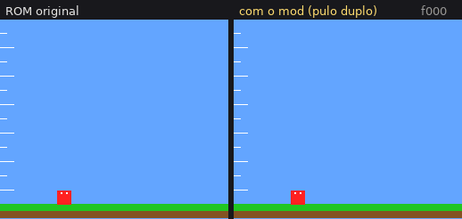
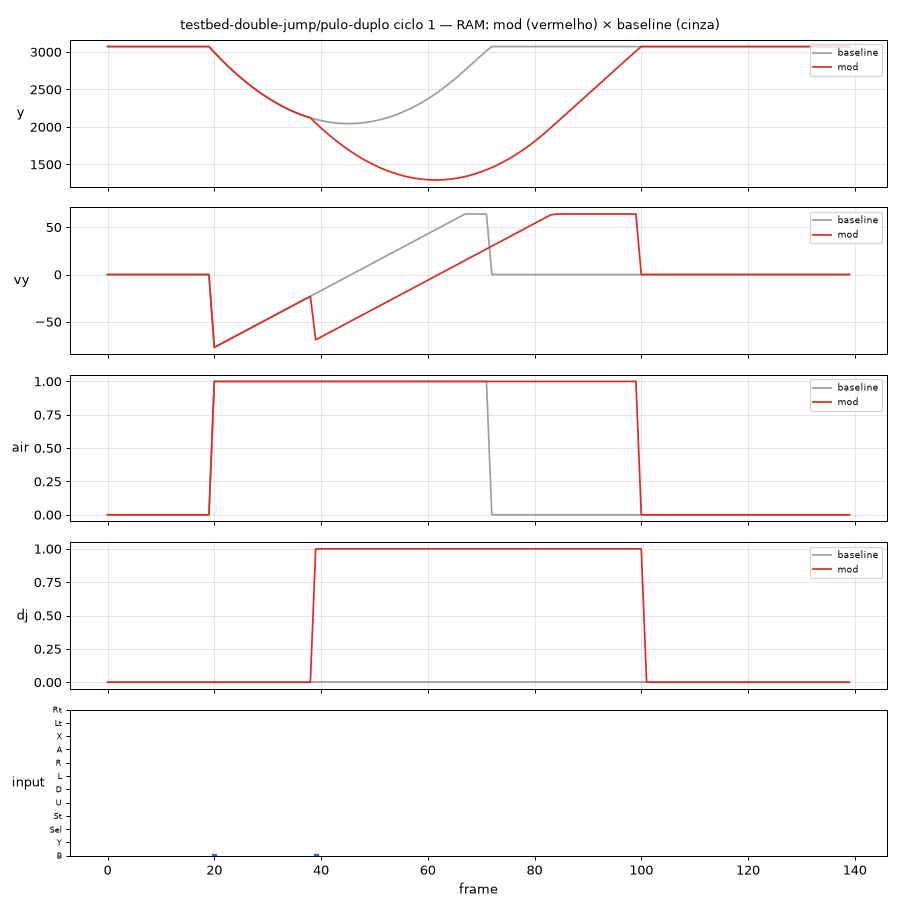

# snes-mods — fábrica de mods de Super Nintendo com agentes

<p align="center">
  <a href="https://github.com/frederico-kluser/snes-mods/actions/workflows/ci.yml"></a>
  <a href="https://github.com/frederico-kluser/snes-mods/actions/workflows/codeql.yml"></a>
  <a href="https://securityscorecards.dev/viewer/?uri=github.com/frederico-kluser/snes-mods"></a>
  <a href="LICENSE"></a>
  <a href="https://www.conventionalcommits.org/"></a>
  
  
</p>

> **English summary** — An agent-driven factory for Super Nintendo (SNES) ROM hacks. Hand it a ROM and a
> goal: it reverse-engineers the game (headless MesenCE emulation with Lua probes + Ghidra/ghidra-snes),
> writes the 65816 patch with Asar and runs an **autonomous evolution loop** that replays a savestate on
> the original and the modded ROM, records frames, video and RAM traces, scores objective checks and
> decides whether the mod improved. Built for Claude Code (skills + CoALA memory + REA MCP), usable by any
> coding agent through the `fab` CLI. Documentation is in Portuguese.

Você passa a ROM e diz o que quer. O agente (Claude Code ou outro) registra a ROM, investiga o jogo
no emulador e no Ghidra, escreve o patch em assembly 65816 (Asar) e entra num **ciclo autônomo**:
roda o emulador headless a partir de um savestate, grava frames/vídeo/RAM do mod e da ROM original,
compara, avalia critérios objetivos, olha as imagens e decide se houve evolução — até cumprir o objetivo.

<p align="center">
  
</p>

<p align="center"><sub>Ciclo real da fábrica sobre a ROM de teste do repositório: mesmo savestate e mesmos inputs nas duas
ROMs; à direita, o patch de pulo duplo do guia (B no chão e B de novo no ar).</sub></p>

## Como funciona

```
 ROM + pedido ──► fab rom add ──► savestate (fab state boot | fab play + import)
                                       │
          ┌────────────── investigação ┴──────────────────────────┐
          │ dinâmico: MesenCE --testRunner + harness Lua          │
          │   fab ram search/query · fab probe writes/reads/exec  │
          │ estático: Ghidra 12.1.4 + ghidra-snes (headless)      │
          │   fab re cdl → analyze → func/xrefs/decompile         │
          └──────────────── evidence_id ──────────────────────────┘
                                       │
                   mods/<id>/patch.asm + mod.json (cenários + checks)
                                       │
        ┌──────────────── fab cycle run (snes-mod-cycle) ───────────────┐
        │ Asar na cópia → baseline (ROM limpa) × mod, mesmo state/macro │
        │ frames 256x224 · vídeo · traços de RAM · sondas M/X           │
        │ compare.png · trace_compare.png · checks → pontuação          │
        │ veredito automático + veredito visual do agente → ledger      │
        └────────────── repete até objetivo-cumprido ───────────────────┘
                                       │
                        build/<id>/<id>.bps + relatório
```

## Instalação

Requisitos: Windows 10/11 x64, Python 3.11+, Git e (opcional) Node.js ≥ 22.19 para o MCP do REA.

```bash
git clone https://github.com/frederico-kluser/snes-mods.git
cd snes-mods
./fab setup     # baixa e verifica (sha256) o toolchain pinado em tools/manifest.json (~1 GB)
./fab doctor    # tudo OK?
./fab selftest  # testes unitários + ponta a ponta no emulador headless
```

No PowerShell use `.\fab.ps1`; no cmd, `fab.cmd`. O toolchain fica em `tools/` (fora do git) e as
dependências Python numa `.venv` local.

## Como usar

1. Abra o Claude Code na pasta do projeto.
2. Peça, por exemplo: *"Aqui está a ROM `D:\roms\MeuJogo.sfc`. Quero que o personagem pule mais alto."*
   - Se tiver, passe também um savestate do Mesen/MesenCE (`.mss`) no momento do jogo que interessa;
     se não, o agente tenta chegar lá sozinho (`fab state boot`) ou pede para você salvar um com
     `./fab play <jogo>` + **Shift+F1**.
   - Vídeos ou prints que você gravar vão em `media/inbox/` (o agente roda `fab media inbox`).
3. O agente segue as skills `snes-mod-factory` → `snes-mod-cycle` e entrega o `.bps`, o `patch.asm` e o
   relatório dos ciclos (`cycles/<mod>/…/report.md`).

Comandos à mão: `./fab --help`. Referência completa: [`.agents/snes-mod-factory/references/cli.md`](.agents/snes-mod-factory/references/cli.md).

## Exemplo funcionando (sem ROM comercial)

[`fixtures/testbed/testbed.asm`](fixtures/testbed/testbed.asm) é uma ROM homebrew (LoROM, 1 MB, código
próprio) com um bloco que anda e pula — e a rotina de pulo fica **exatamente** nos endereços do guia
(`$80:A41E–$80:A438`). [`mods/testbed-double-jump/patch.asm`](mods/testbed-double-jump/patch.asm) é o
patch de "salto duplo" do guia, literal. Um ciclo:

```
./fab cycle run mods/testbed-double-jump
→ 6/6 checks ✅ · hijack 80:A420 OK (JML $90:8008, 4 bytes, sem órfãos) · M/X dinâmico m8,x16 em 140/140
→ pulo duplo: imagens divergem a partir do f40 (2º B no f39 + 1 frame de exibição)
→ regressão (pulo simples): 0/35 frames divergentes
```

<p align="center">
  
</p>

As evidências de cada endereço usado no patch estão em
[`mods/testbed-double-jump/README.md`](mods/testbed-double-jump/README.md).

## O que tem aqui

| caminho | o quê |
|---|---|
| `snesfab/` | a CLI `fab` (Python): ROM e mapas, emulação headless, mídia, comparação, critérios, build Asar + BPS, ciclo, lane do Ghidra, investigação dinâmica |
| `lua/harness.lua` | roda dentro do MesenCE `--testRunner`: savestate, input, frames, RAM, sondas com M/X, CDL |
| `ghidra_scripts/` | sementes M/X + análise, export TSV e descompilação (headless) |
| `.agents/` | skills dos agentes (`snes-mod-factory`, `snes-mod-cycle`, `snes-rea-modder`) e a memória CoALA local |
| `fixtures/testbed/` | a ROM homebrew de teste |
| `mods/`, `games/`, `cycles/` | mods, notas por jogo e o histórico dos ciclos (sem material comercial) |
| `tools/manifest.json` | toolchain pinado com sha256 |

## Toolchain (pinado em `tools/manifest.json`, instalado em `tools/`, fora do git)

| ferramenta | versão | papel |
|---|---|---|
| MesenCE (sucessor do Mesen2) | 2.2.1 | emulador; `--testRunner` headless + Lua (state, input, frames, RAM, sondas, CDL) |
| Asar | 1.91 | montador 65816 (`--fix-checksum=on --symbols=wla`, autoclean/freecode) |
| Ghidra | 12.1.4 | análise estática headless |
| ghidra-snes (joshleaves) | v1.3.0+2 (`d33ce5d`), recompilado | loader LoROM/HiROM/ExHiROM/SA-1 + língua `65816:LE:24:snes` |
| Temurin JDK | 21.0.12.1 | Ghidra/gradle |
| ffmpeg (gyan.dev) | 2026-10-22 | vídeo, extração de frames, cenas, movimento |
| rea-agents (npm local) | 6.7.0 | servidor MCP do REA, registrado só neste projeto (`.mcp.json`) |
| Python | 3.11+ com numpy, Pillow, matplotlib (`.venv`) | CLI `fab` |

## Decisões e desvios em relação ao guia (verificados em 2026-10-24)

- **REA não abre ROMs de SNES na versão publicada (6.7.0).** `rea inspect rom.sfc` → `unsupported
  binary format`; o modo raw só aceita `6502|x86|x86_64|arm|arm64|m68k`. O suporte a 65816 está no
  PR morluto/rea#4911 (aberto; nele o Windows ainda recusa raw 65816 e não há mapeamento LoROM/HiROM).
  Por isso o lane estático é o Ghidra + ghidra-snes chamado diretamente (`fab re`), com o **mesmo
  contrato de evidência** do REA (`evidence_id`, `analysis_profile`, `normalized_result`,
  `limitations`). O REA está instalado e registrado (MCP, 207 ferramentas, provedor Ghidra disponível)
  para os outros alvos e para quando o 65816 entrar.
- **Registro do REA só no projeto** (`.mcp.json` + skill copiada), não global.
- **Mesen2 → MesenCE**: o repositório do Mesen2 foi arquivado em 2026-06; o MesenCE (nesdev-org) é a
  continuação oficial. Configuração portátil em `tools/mesen/settings.json` (Lua I/O liberado, controle
  SNES na porta 1, RAM inicial zerada, frame skipping desligado).
- **ghidra-snes** só tem release para o Ghidra 12.0.4: é recompilado contra o 12.1.4 pelo `fab setup`.
- **Sementes M/X do CDL**: o loader não segue os vetores; a análise é semeada com os vetores e com as
  entradas de sub-rotina do Code/Data Log do MesenCE, que registra M/X por instrução executada.
- **Ciclo**: o guia para no build; aqui o build é validado no emulador contra a ROM original, com
  critérios, imagens e ledger append-only.

## Contribuindo

Contribuições são bem-vindas! Leia o [CONTRIBUTING.md](CONTRIBUTING.md) (ambiente, branches
`<tipo>/<slug>`, Conventional Commits, testes) e o [Código de Conduta](CODE_OF_CONDUCT.md). Dúvidas e
ideias: [Discussions](https://github.com/frederico-kluser/snes-mods/discussions).

## Segurança

Não reporte vulnerabilidades em issues públicas — veja o [SECURITY.md](SECURITY.md) (Private
Vulnerability Reporting).

## Versionamento

[SemVer](https://semver.org/lang/pt-BR/) calculado a partir dos commits; o release-please mantém o PR de
release e o [CHANGELOG.md](CHANGELOG.md).

## Legal

Use apenas ROMs que você possui. Nada derivado de jogos comerciais é versionado (ROMs, states,
builds, BPS, frames, vídeos, exports do Ghidra). Para compartilhar um mod, distribua `patch.asm` e/ou
o `.bps`.

## Licença e créditos

Código deste repositório sob a licença [MIT](LICENSE). O `fab setup` baixa das fontes oficiais, sem
redistribuir, ferramentas com licenças próprias: [MesenCE](https://github.com/nesdev-org/MesenCE)
(GPL-3.0), [Ghidra](https://github.com/NationalSecurityAgency/ghidra) (Apache-2.0),
[ghidra-snes](https://github.com/joshleaves/ghidra-snes) (MIT), [Asar](https://github.com/RPGHacker/asar)
(LGPL-3.0/GPL-3.0/WTFPL), [ffmpeg](https://ffmpeg.org) (builds GPL da gyan.dev),
[Eclipse Temurin](https://adoptium.net) (GPL-2.0 com Classpath Exception) e
[REA](https://github.com/morluto/rea) (MIT). A memória CoALA (`.agents/snes-mods-coala-agent-skill`,
motor `coala.py` incluído) vem da coala-agent-skill do mesmo autor, também sob MIT.
